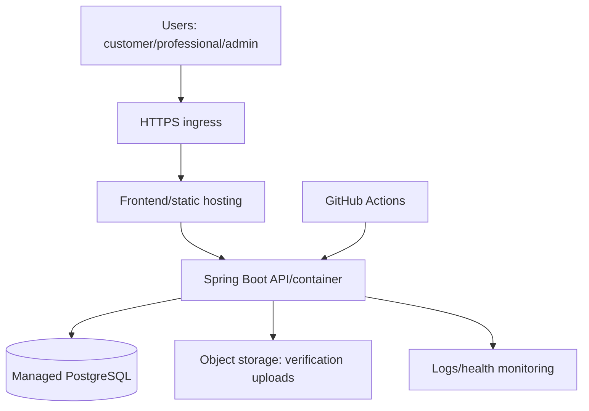

# Cloud Architecture and Deployment Plan

## Proposed prototype architecture
Browser -> HTTPS ingress/reverse proxy -> Spring Boot API and static frontend -> managed PostgreSQL database; object storage for uploaded verification documents; application logs and health metrics. Use environment-based secrets and least-privilege service accounts.

## Diagram (logical)

## Deployment checklist
- [ ] Select provider and region; document student/free-tier limits
- [ ] Provision managed PostgreSQL; use strong generated secrets
- [ ] Provision object storage and private bucket policy
- [ ] Set environment variables; never commit secrets
- [ ] Build and deploy Docker containers
- [ ] Configure TLS/HTTPS and secure cookies
- [ ] Restrict admin access; review IAM/RBAC
- [ ] Configure backups, retention and restore test
- [ ] Health-check and smoke-test deployed URL
- [ ] Capture monitoring/log screenshots
- [ ] Configure budget alerts and shutdown/cleanup plan

## Reliability/scaling
Keep API stateless where possible; externalize uploads and database; use managed backups; use a session store or sticky sessions if scaling instances; rate-limit sensitive endpoints; deploy replicas only after concurrency constraints are addressed. The current booking duplicate check is process-level and should not be considered safe for multi-instance production until database uniqueness/transaction locking is implemented.

## Security and privacy
HTTPS; secrets in platform secret manager; least privilege; encrypt transit and storage; upload size/type validation; avoid logging personal data; access-control uploaded documents; data retention/deletion policy.

## Cost estimate worksheet
Provider-specific prices change. Estimate monthly costs by line item (compute, database, storage, egress, monitoring) for 100/1,000/10,000 users using the chosen provider's current calculator. This document intentionally leaves amounts TBD until provider/region/service tiers are selected.
